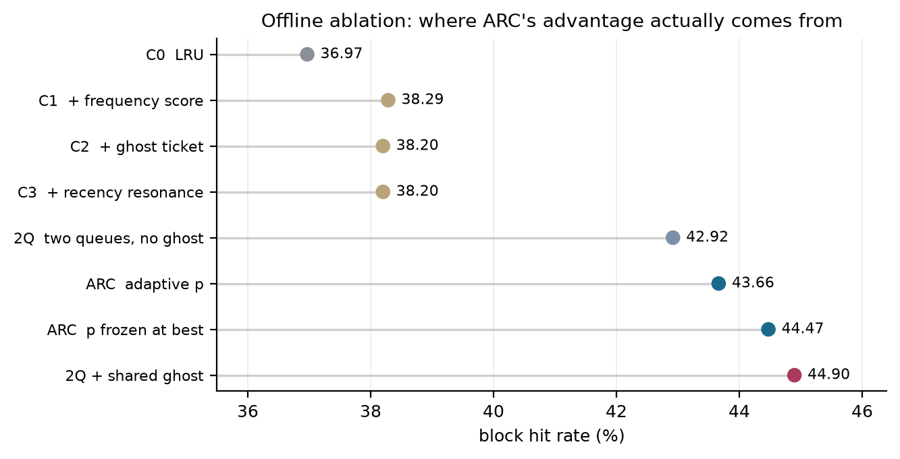
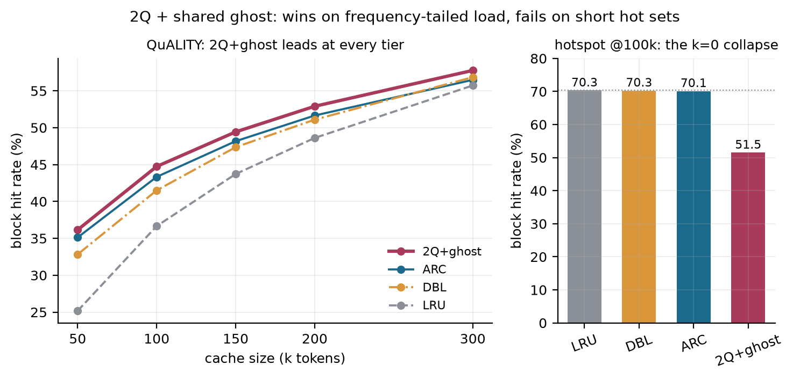
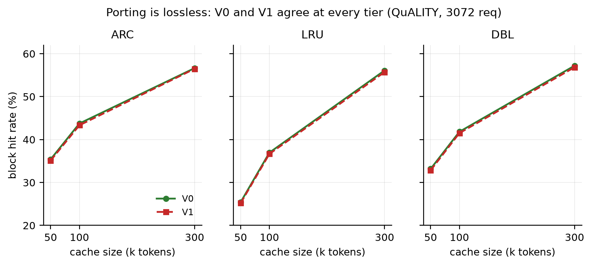
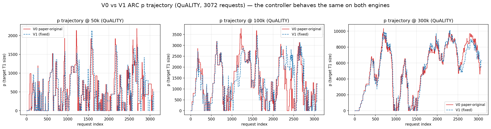

# vllm-arc-evictor

ARC (Adaptive Replacement Cache) eviction for the **vLLM V1** KV cache — ported from the
V0 implementation the paper shipped, plus a controlled ablation of which parts of ARC
actually earn their keep.

The paper's own fork only touches `vllm/core/`; `vllm/v1/` was never modified. V1 removed
the pluggable `Evictor` base class, so the policy has to be re-attached by reimplementing
the `FreeKVCacheBlockQueue` interface. The port below reproduces V0 to within 0.3 pp —
and getting there meant fixing eleven adapter-layer traps, four of which fail **silently**.
They are written up in [docs/migration-v0-v1.md](docs/migration-v0-v1.md).

**Status:** research code, validated on one model and one trace per workload.
**Engine:** vLLM 0.26.0 (V1), CUDA 13.0, single 32 GB vGPU, DeepSeek-R1-Distill-Qwen-1.5B.

---

## The finding

Two results, one positive and one negative.

**ARC's advantage is not where the paper's framing suggests.** An offline ablation that
adds one mechanism at a time shows the block-level ghost contributes **exactly zero**.
What pays is the recency/frequency partition itself. Freezing `p` at its best value beats
adaptive `p` by **0.81 pp**, i.e. the delta controller is a net cost on this workload.

**Removing both penalties produces a policy that beats ARC — and then breaks.** Keeping the
two queues, deleting `p` and `delta`, and collapsing `B1`/`B2` into one shared ghost gives
**44.90%** vs ARC's **43.66%** offline, and leads at all five cache tiers online. On a
short-hot-set workload the same policy collapses **18.6 pp below ARC** (18.8 pp below
LRU), because `k = 0` leaves T1 without a floor.



| policy | hit rate | vs LRU | vs ARC |
|---|---|---|---|
| C0 LRU | 36.97% | — | −6.70 |
| C1 + frequency score | 38.29% | +1.32 | −5.38 |
| C2 + ghost ticket | 38.20% | +1.23 | −5.46 |
| C3 + recency resonance | 38.20% | +1.23 | −5.46 |
| 2Q, two queues, no ghost | 42.92% | +5.95 | −0.74 |
| ARC, adaptive `p` | 43.66% | +6.70 | — |
| ARC, `p` frozen at best | 44.47% | +7.50 | +0.81 |
| **2Q + one shared ghost** | **44.90%** | **+7.93** | **+1.23** |

The two-queue structure alone already captures 89% of ARC's advantage over LRU. The ghost
adds the rest only when it is decoupled from the queue-size budget.

---

## Results

### QuALITY (3072 requests, 5 cache tiers, `batch=1`)

| cache | 2Q+ghost | ARC | DBL | LRU |
|---|---|---|---|---|
| 50k | **36.15** | 35.12 | 32.83 | 25.17 |
| 100k | **44.74** | 43.33 | 41.50 | 36.66 |
| 150k | **49.43** | 48.17 | 47.36 | 43.72 |
| 200k | **52.90** | 51.65 | 51.09 | 48.61 |
| 300k | **57.76** | 56.48 | 56.84 | 55.72 |

Block hit rate, in percent. 2Q+ghost leads at every tier by roughly one point; its lead
over LRU is widest at the smallest cache (11 pp) and narrows with capacity, matching the
paper's shape. At 100k the offline simulator and the online run agree to **0.35 pp**
(44.897 vs 44.74), which is what validates the implementation.



### hotspot (12000 requests, 100k cache) — the honest counterexample

| policy | hit rate | TTFT |
|---|---|---|
| LRU | 70.33% | 37.9 ms |
| DBL | 70.29% | 37.6 ms |
| ARC | 70.14% | 40.4 ms |
| 2Q+ghost | **51.52%** | 44.8 ms |

On a shared-system-prefix workload the first three are indistinguishable — the hit rate is
set by the prefix, not by the policy. 2Q+ghost is the only one that moves, and it moves
down. The eviction trace says why: T1 receives only fresh misses, T2 takes 2.4× the
traffic, T1 hits on 2.8% of references, and **40.8%** of all evictions are forced out of T2
because T1 is empty. This is structural, not a bug — see [open problem](#open-problem).

---

## V0 → V1: the port is lossless



| cache | V0 ARC | V0 LRU | V0 DBL | V1 ARC | V1 LRU | V1 DBL |
|---|---|---|---|---|---|---|
| 50k | 35.40 | 25.41 | 33.17 | 35.12 | 25.17 | 32.83 |
| 100k | 43.75 | 36.96 | 41.82 | 43.33 | 36.66 | 41.50 |
| 300k | 56.64 | 56.10 | 57.21 | 56.48 | 55.72 | 56.84 |

ARC's edge over LRU: **+9.99 / +6.79 / +0.54 pp** on V0, **+9.95 / +6.67 / +0.76 pp** on
V1. The `p` steady state also survives the port (mean 482 vs 506 at 50k, 5345 vs 5388 at
300k), and the trajectory itself is near-identical tier by tier.



The spike-then-collapse shape is ARC's own behaviour on windowed Zipf load, not an artifact
of the port — the paper describes the same migration between recency and frequency in its
Figure 7. It is worth stating plainly because this project spent several days convinced the
opposite, and the plot was originally captioned as evidence for it.

The path there is not obvious. [`docs/migration-v0-v1.md`](docs/migration-v0-v1.md)
documents the eleven traps, including the one that cost the most: `append_n()` bypassing
`add()` left every in-flight block pinned in `T1_active`, so `_replace()` was never
reached and ARC silently degraded to T1-FIFO — 20 pp of hit rate, with no exception raised.

---

## Reproduce

Offline (block-level simulator, deterministic, validated against the online run to 0.02%):

```bash
pip install numpy
python sim/make_trace.py --selftest   # checks the trace format, needs no data
python sim/make_trace.py --quality-json quality.json --model <hf-model> \
    --out dataset/trace_quality.npz
cp customized_evictor_full_dbl.py <site-packages>/vllm/core/customized_evictor.py
python sim/sweep_c.py                 # C0–C3 ladder
python sim/sweep_2q.py                # two queues only
python sim/sweep_2q_ghost.py          # plus shared ghost
python sim/_verify_ghost_coupling.py  # B2 starvation vs capacity
```

Online: copy the kernel into `vllm/core/customized_evictor.py`, wire `arc_queue_full.py`
into the V1 block pool, then select the policy by environment variable:

```bash
export VLLM_EVICTOR=ARC          # ARC | LRU | DBL | TWOQ_GHOST
export VLLM_CACHE_TOKENS=100000  # cache budget in tokens
export VLLM_CACHE_BLOCKS=6250    # VLLM_CACHE_TOKENS / 16
```

Block hit rate must be read from `num_new_computed_tokens`, not
`request.num_computed_tokens` — under chunked prefill the latter is scheduler progress and
produces hit rates that are off by an order of magnitude in both directions.

Figures regenerate from the tables in this README:

```bash
pip install matplotlib
python docs/figures/make_figures.py
```

---

## Open problem

2Q+ghost needs a T1 floor. A fixed `k > 0` fixes hotspot and ruins QuALITY — offline, hit
rate falls monotonically from 0.449 at `k = 0` to 0.15 at `k = 6248`. What is wanted is an
*adaptive* floor: zero for frequency-tailed load, raised for short-hot-set load. That is
exactly what ARC's `p` does, and 2Q+ghost exists because `p` was removed. Recovering
adaptivity while avoiding the two penalties identified above (the delta controller at
−0.79 pp, the `B1`/`B2` complementary coupling at −0.44 pp) is the open question.

## Known gaps

- The QuALITY trace is **not committed** — it is a derived artifact of a dataset we do not
  own, and a binary blob would hide the sampling choices. `sim/make_trace.py` rebuilds it
  from the public corpus. It will not bit-match the original file (that one lived on the
  experiment server), so expect absolute hit rates to move slightly; the policy ranking is
  what the sweeps reproduce.
- The `block_pool.py` change that routes `VLLM_CACHE_BLOCKS` into the physical block count
  lives only on the experiment server. Without it every sweep tier clamps to one cache size
  and reports an identical hit rate — see trap 9 in the migration notes.
- One model, one trace per workload. No random seeds, no error bars. Treat single-digit
  decimal places as illustrative.
- The offload axis is inconclusive: the same configuration drifted between −7.95% and
  +23.46% across sessions, larger than any effect it was meant to measure.
- DBL is used as a reference implementation and is not independently tuned.

## Layout

```
customized_evictor_full_dbl.py   L2 kernel: ARC + DBL + shared ghost (three-in-one)
customized_evictor_2q_ghost.py   L2 kernel: 2Q + shared ghost
customized_evictor_full.py       L2 kernel: ARC only
arc_queue_full.py                L3 adapter: FreeKVCacheBlockQueue-compatible shell
sim/                             offline simulator and sweep drivers
docs/migration-v0-v1.md          the eleven traps
docs/figures/                    generated by make_figures.py
```

## License

Apache-2.0, aligning with vLLM. See [LICENSE](LICENSE).
